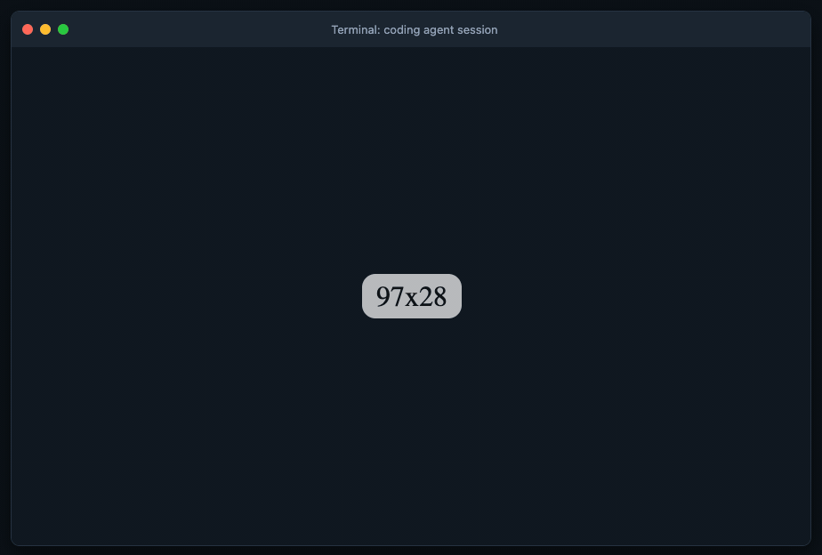

# Keyrelay

**Your agent needs an API key, then tells you not to paste it into chat. Keyrelay gives you somewhere else to enter it.**

[Product page](https://keyrelay.colefoster.ca) · [Setup](#setup) · [Security model](#security-model)

“Don’t paste your API key here.” Okay. Where, then?



Give your agent Keyrelay. It starts the command and shows you a local link. Open that link, review what will run, and enter the key in your browser. Keyrelay passes it once to the waiting command through an environment variable or standard input, so the agent can keep working without you pasting the key into the conversation.

- Runs locally by default. No account, server setup, or Tailscale required.
- Starts a temporary loopback-only broker and closes it when the command finishes.
- Requests live in memory and expire after five minutes.
- Plain-text echoes of the credential are redacted from captured command output.
- Optional Tailscale broker for handoffs from another device.

## Setup

**Keyrelay does not require a GitHub account, API key, or any other credential to install.** You only supply a credential later, when a command you choose needs one. That credential goes to your local command, not to the Keyrelay website or its maintainer.

Install **Node.js 18+** (includes `npx`) and **Python 3.9+**, then check the CLI:

```sh
npx keyrelay --help
```

`npx` downloads the launcher and bundled Python implementation. This command displays help; it does not request a credential. You do not need to clone this repository, start a server, configure networking, or install Tailscale.

If you prefer a permanent command:

```sh
npm install -g keyrelay
keyrelay --help
```

### Try it with a made-up value

This demo needs no account or real secret. It runs a local Node.js command that confirms it received a value without printing that value:

```sh
npx keyrelay run --env DEMO_TOKEN -- node -e "console.log(process.env.DEMO_TOKEN ? 'Handoff complete.' : 'No value received.')"
```

Open the printed `http://127.0.0.1:…/r/…` link **on the same computer**, review the command, enter **`demo-value`**, and select **Send once**. The terminal prints `Handoff complete.` and the temporary broker shuts down.

The link expires after five minutes; Ctrl+C cancels the handoff. Keyrelay prints the link rather than opening a browser automatically.

## Use with a coding agent

Add this to your agent instructions:

> When a command needs multiple credentials, use repeated `--field NAME=Label` options so the user gets separate password fields; do not ask them to assemble JSON. The target command must accept a JSON bundle. For one credential, run it with `npx keyrelay run --env VARIABLE -- COMMAND` (or `--stdin`) and show me the printed one-time link. Replace VARIABLE with the environment variable the tool expects and COMMAND with the actual command. Leave the runner waiting while I enter the credential in my browser. Never ask me to paste credentials into the conversation. The link opens on the computer running the command; use a configured Tailscale broker with `--url` for remote agents.
>
> When a task needs me to sign in, create an account, or trade a password for a token, use `npx keyrelay exchange` with `--action`, `--host`, and `--returns` describing exactly what will happen. The target command reads the values as JSON on stdin and writes only the derived result (for example an API key) to `$KEYRELAY_RESULT_FD`. Never put my values in command arguments. If the sign-in has 2FA, a CAPTCHA, or SSO, open the page in a browser I can see and let me sign in myself.

Keyrelay hands a credential to the command you specify. It does not create API keys or decide which permissions a tool needs. Install the target tool separately and use a credential for that tool only when its task requires one.

For example, **only if you want a command to access GitHub using a token**, and already have the GitHub CLI installed:

```sh
npx keyrelay run --env GITHUB_TOKEN -- gh api user
```

That token is passed to `gh`. GitHub access is an optional example, not a Keyrelay setup step. If `gh` is already authenticated, you can run `gh api user` directly.

For a tool that accepts a credential on standard input, use `--stdin` instead of `--env VARIABLE`. For example, `gh auth login --with-token` accepts stdin and persists the resulting login; the target tool controls that storage.

The runner returns the command's exit status and redacted output after the command finishes. Interactive commands that need a terminal are not supported. Exact secret echoes are redacted; transformed or deliberately transmitted secrets are not.

### Multiple credentials in one form

Repeat `--field NAME=Label` for separate password inputs:

```sh
npx keyrelay@latest run --env X_CREDENTIALS_JSON \
  --field 'apiKey=API Key' --field 'apiSecret=API Key Secret' \
  --field 'accessToken=Access Token' --field 'accessTokenSecret=Access Token Secret' \
  -- your-command
```

The user fills four labeled fields. Keyrelay builds a JSON object keyed by the field
names and passes it through the selected environment variable or standard input.
The target command must accept that JSON object; field names are not separate environment
variables. Supports up to 16 fields, unique identifier names, and 16,384 characters for
the complete submitted bundle. Every field is required. Individual values are redacted from captured command output,
as well as the whole bundle. Requires **Keyrelay 0.1.4+** on both the runner and a remote broker. Update a global
installation with `npm install -g keyrelay@latest`; update and restart a self-hosted
broker before using fields. Existing single-key commands continue to work.

### Instructions and checking values

With **0.1.5+** on both runner and broker, add `--note` for instructions above the
form and repeat `--field-help NAME=Instructions` for help beneath a named field:

```sh
npx keyrelay@latest run --env X_CREDENTIALS_JSON \
  --note 'Use the app account. Enable Read and write before generating access tokens.' \
  --field 'apiKey=API Key' --field-help 'apiKey=Developer Console > App > Keys and tokens.' \
  --field 'apiSecret=API Key Secret' \
  --field 'accessToken=Access Token' \
  --field-help 'accessToken=Generate after enabling write permissions.' \
  --field 'accessTokenSecret=Access Token Secret' \
  -- your-command
```

Notes also work with single-key requests. Text is displayed literally (no HTML or
Markdown); line breaks are preserved. Notes allow up to 2,000 characters, field
help up to 1,000. Field help must name an existing field and may be supplied once
per field. **Never include credentials in labels, notes, help, or command arguments**:
these are request metadata, not secret inputs.

Every form includes **Show values / Hide values** for checking pasted credentials.
Values start hidden and are cleared and hidden again when you submit, including
after a failed attempt. Neither help text nor the visibility control changes the
credential bundle delivered to your command.

## Sign-ins and account creation: `keyrelay exchange`

Some tasks need a password, not an API key: create the first admin account, sign in
once, trade a username and password for a token. `run` would hand the agent's command the
password and print whatever it prints. `exchange` is stricter. **You type the
values and approve the exact action. The agent gets back only the result the command
marks as its output, such as a new API key, a session token, or success or failure.**

```sh
npx keyrelay@latest exchange \
  --action 'Sign in to the app and return a session token' \
  --host https://app.example.test \
  --returns 'A session token (no password)' \
  --field 'email=Email' --field-visible email \
  --field 'password=Password' \
  -- sh -c 'jq -c "{email, password}" | curl -sf -H "Content-Type: application/json" --data @- "$1/api/auth/login" | jq -c "{token: .accessToken}" >&"$KEYRELAY_RESULT_FD"' sh https://app.example.test
```

The browser form shows a review screen before anything runs:

- **Action**: what approving does (`--action`).
- **Target host**: the host the command will contact (`--host`).
- **Command**: the exact argv that will run.
- **Your values go to**: the command's standard input, as JSON.
- **Returned to the agent**: what comes back (`--returns`), plus the command's output with your values removed.

Select **Approve and send once** to run it a single time. `--field-visible NAME` shows a username or email as plain
text; every other field is a password input. `--note` and `--field-help` work as they do with `run`.

### Contract for the target command

- **Input:** one line of JSON on standard input, keyed by field name, for example `{"email": "…", "password": "…"}`.
  Values never go into argv, the environment, or a file.
- **Result:** write one JSON value, at most 64 KiB, to the file descriptor named in `$KEYRELAY_RESULT_FD`
  (in a shell, `>&"$KEYRELAY_RESULT_FD"`; in Python, `os.fdopen(int(os.environ["KEYRELAY_RESULT_FD"]), "w")`).
- **Log:** anything on stdout or stderr is shown to the agent on stderr, with typed values redacted.
  Keyrelay also redacts their URL-encoded, JSON-escaped, base64, and HTTP Basic (`user:password`) forms.
- **Don't** pass values to a child process as arguments. `curl -d "$PASSWORD"` puts the password
  in the process list, but `curl --data @-` reads it from stdin.

Keyrelay prints one JSON report on **stdout**: `{"ok": true, "exit_code": 0, "result": …}`, or `"ok": false`
with an `"error"`. **Keyrelay withholds the result when it contains a value you typed**, in plain or encoded form.
It does the same when the result is missing, invalid JSON, larger than 64 KiB, or the descriptor stays open after the
command exits. The exit status is the command's own status, or 1 when it succeeded without a usable result. The link
and progress messages go to stderr, so `keyrelay exchange … > result.json` captures only the report.

Exchange needs macOS or Linux and **Keyrelay 0.1.6+** on both the runner and any remote broker. An older broker is refused.

### Worked example: Immich first-run admin and an API key

[`examples/immich_api_key.py`](examples/immich_api_key.py) uses only the Python standard library. It reads
`{email, password}` and calls `POST /api/auth/admin-sign-up` (with `--signup`) and `POST /api/auth/login`. It
creates a key with `POST /api/api-keys`, then logs out so the sign-in session dies. It returns only the key:

```sh
git clone https://github.com/colefoster/keyrelay.git && cd keyrelay
python3 keyrelay.py exchange \
  --action 'Create the Immich admin account, sign in once, and create an API key' \
  --host http://192.168.0.2:2283 \
  --returns 'A new Immich API key named "agent" with all permissions' \
  --field 'email=Admin email' --field-visible email \
  --field 'password=Admin password' \
  --field-help 'password=Becomes the admin password. Immich stores only its hash.' \
  -- python3 examples/immich_api_key.py --url http://192.168.0.2:2283 --signup --name Cole --key-name agent
```

The agent receives:

```json
{"ok": true, "exit_code": 0, "result": {"apiKey": "…", "id": "…", "name": "agent", "permissions": ["all"], "url": "http://192.168.0.2:2283"}}
```

Drop `--signup` to sign in to an existing account. Use repeated `--permission`, such as `--permission asset.read
--permission asset.upload`, for a narrower key than `all`. The result holds a live API key, so it is in the agent's
context from then on. That is the point, but scope the key to what the agent needs, and revoke it in Immich under
**User Settings > API Keys** when the task is done.

### From your phone or another device

`exchange` uses the same broker API as `run`, so the [Tailscale broker](#optional-use-another-device-with-tailscale)
works unchanged. Add `--url https://your-broker.your-tailnet.ts.net` and open the printed link on your phone.
The review screen, the password, and the approval stay on the Tailnet path between your phone and the broker. The
target command still runs on the agent's machine. Update the broker to 0.1.6+ first, or the runner stops with
"Broker does not support exchange".

### Sites with 2FA, CAPTCHAs, or SSO

If a sign-in can't be scripted, don't script it. Have the agent open the page in a browser you can both see, and
sign in yourself. See [Browser handoff](docs/browser-handoff.md) for the pattern, the rules the agent follows while
you type, and a worked example.

### Without Node.js

Clone the repository and use the Python CLI directly:

```sh
git clone https://github.com/colefoster/keyrelay.git
cd keyrelay
python3 keyrelay.py --help
```

Use `python3 keyrelay.py run` with the same arguments as `npx keyrelay run`.

## Optional: use another device with Tailscale

Local links work only on the machine running the command. To enter credentials from your phone or another computer, run a persistent broker behind Tailscale. You need Tailscale on the broker and client devices and HTTPS enabled in your Tailnet.

```sh
npx keyrelay serve --email you@example.com
```

In another terminal:

```sh
tailscale serve --bg http://127.0.0.1:8765
```

Use the HTTPS URL printed by Tailscale:

```sh
npx keyrelay run \
  --url https://your-broker.your-tailnet.ts.net \
  --env DEMO_TOKEN -- python3 -c "print('Handoff complete.')"
```

Keep the backend on localhost; only the trusted Tailscale Serve proxy should supply identity headers. **Do not use Tailscale Funnel or a public reverse proxy.**

For a persistent Linux service, first clone this repository and enter its directory (as shown above). Edit `keyrelay.service` to replace `you@example.com` with your Tailscale login, then run:

```sh
sudo install -d /opt/keyrelay
sudo install -m 644 keyrelay.py /opt/keyrelay/keyrelay.py
sudo install -m 644 keyrelay.service /etc/systemd/system/keyrelay.service
sudo systemctl daemon-reload
sudo systemctl enable --now keyrelay.service
```

The optional `--auth whois` mode is for the maintainer's existing private nginx deployment. It expects a trusted `X-Real-IP` header and the `key.colefoster.ca` Host header. Use the default Tailscale Serve mode for your own installation.

## Security model

Keyrelay keeps credentials out of the normal chat handoff. **It is not a sandbox or a defense against a malicious agent or command.** Review the displayed command and use it only on trusted machines with agents you trust.

The broker holds requests and submitted secrets in process memory. Expired entries are removed on the next request; expiry is not guaranteed memory erasure. A successful claim deletes the entry. Restarting the broker discards pending requests. Keyrelay does not write credentials to a database or log HTTP requests.

The runner captures stdout and stderr, replacing exact copies of the secret before displaying them. Encoded, transformed, or deliberately transmitted credentials are not covered. The command receives the real credential and can store it; authenticated CLIs may persist sessions. Other software with sufficient access to the broker or runner can read process memory or environments. Use narrowly scoped, short-lived credentials where possible.

In local mode, the broker binds only to `127.0.0.1` on a randomly assigned port. It checks the exact Host header to reject DNS rebinding and rejects cross-origin POSTs. Local programs and users on the same machine remain trusted: this is not OS-user authentication. Do not forward the port or expose it through a proxy.

In Tailscale mode, only the configured Tailscale identity is allowed to access the broker. All requests by that identity share the same trust boundary; this is a personal handoff tool, not a multi-tenant secret manager.

### Exchange: what it protects and what it doesn't

`exchange` keeps your password out of the agent's context, the command's argv and environment, shell history, and
disk. Values travel browser → broker memory → runner memory → the command's stdin pipe. Tests check this against a
local stub: the process table while the command runs, the temp, home, and working directories, and everything on stdout and stderr.
It does not make an untrusted command safe:

- **The target command sees your password.** It can store it, send it somewhere else, or encode it in a way
  redaction misses (for example, hex or encryption). The review screen shows the command line, not the code of a script it runs. An agent
  that can edit `examples/immich_api_key.py` can change what it does. Approve only commands and scripts you trust.
- **`--host` is a declaration, not a firewall.** Keyrelay shows it but cannot make the command contact only that host.
- **The result is real access.** An API key or token in the result is meant for the agent, and the agent keeps it.
  Ask for narrow permissions, and revoke the key when you are done.
- **Result filtering is best effort.** A result that contains your value, plain or in one of the encodings above, is
  withheld. A result that holds a reversible transform of it is not caught.
- **Same-user processes are trusted.** A process running as your OS user can read the runner's memory or attach a
  debugger, as with `run`.
- **The review is only as good as the reading.** The form can't tell whether you read it. A command that looks
  reasonable but points `--url` at a different host than `--host` is the case to look for.

## Development

```sh
python3 -m unittest discover -s tests
python3 -m http.server 8080 --directory site
```

The public product page is static and collects no credentials. It is deployed to Cloudflare Pages separately from the private broker. See [site deployment](https://github.com/colefoster/keyrelay/blob/main/docs/site-deployment.md).

## License

[MIT](LICENSE) © 2026 Cole Foster
